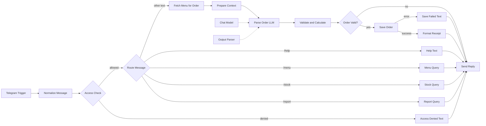
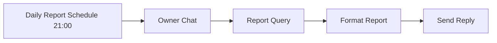
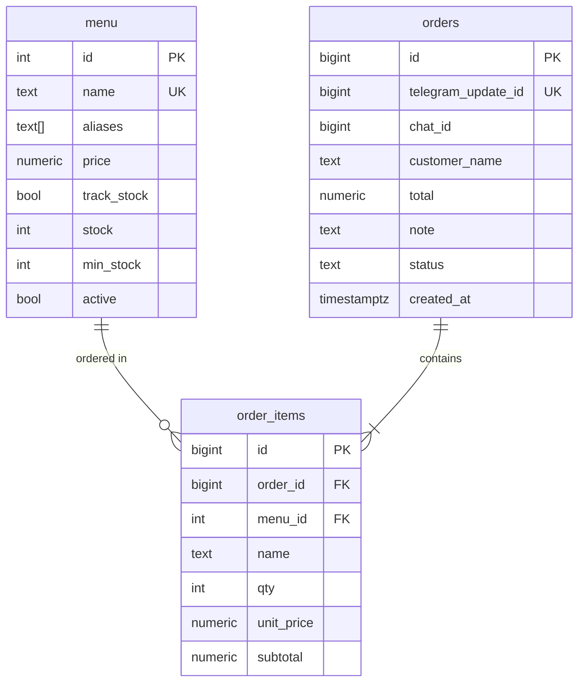

# Stall Order Bot: Order and Sales Report Automation for Small Food Businesses with n8n

A Telegram bot for small food stalls and other micro-businesses. The cashier types an order in plain language, for example `2 nasi goreng, 1 es teh for Budi`. An LLM extracts the items and quantities, then the workflow matches them against the menu, calculates the total, checks stock, saves the order to PostgreSQL, and replies with a short receipt. Every evening a daily sales report is sent to the owner automatically.

The whole system runs as a single **n8n** workflow backed by one PostgreSQL database.

---

## Table of Contents

- [Key Features](#key-features)
- [Design Principles](#design-principles)
- [Architecture](#architecture)
- [Tech Stack](#tech-stack)
- [Repository Structure](#repository-structure)
- [Prerequisites](#prerequisites)
- [Installation](#installation)
- [Workflow Configuration](#workflow-configuration)
- [Usage](#usage)
- [Workflow Details](#workflow-details)
- [Database Schema](#database-schema)
- [Security](#security)
- [Troubleshooting](#troubleshooting)
- [Limitations](#limitations)
- [Roadmap](#roadmap)
- [License](#license)

---

## Key Features

| Feature | Description |
|---|---|
| **Natural-language orders** | Type orders freely. The LLM handles typos, abbreviations (for example "nasgor"), quantities written as words ("two"), customer names, and notes such as "not spicy". |
| **Prices and stock from the database** | The LLM only extracts item names and quantities. Menu matching, prices, totals, and stock checks are computed by code, not by the LLM. |
| **Atomic saves** | The order, its line items, and the stock decrement happen in a single SQL statement. Everything succeeds or nothing does. |
| **Idempotent** | A repeated Telegram update (for example a retry) does not create a duplicate order, thanks to `UNIQUE telegram_update_id`. |
| **Low-stock warnings** | The receipt warns when an item that was just ordered has reached its minimum stock level. |
| **Automatic daily report** | Every day at 21:00 (Asia/Jakarta): number of orders, revenue, and the top 5 items are sent to the owner. |
| **Quick commands** | `/menu`, `/stock`, `/report`, `/help`. |
| **Access control** | Only allow-listed chat IDs can use the bot. |
| **Error handling** | Non-order messages, unknown menu items, insufficient stock, and database failures each get a clear reply. |

---

## Design Principles

1. **The LLM extracts, code decides.** LLM output is never trusted for prices or stock. Item names from the LLM are strictly matched against the `menu` table (names and aliases). Unmatched items are rejected, not guessed.
2. **A single source of truth.** Menu, prices, and stock live only in PostgreSQL. Changing a price is an `UPDATE` in the database, with no workflow edits.
3. **Safe to repeat.** Telegram webhooks can be delivered more than once. A database constraint guarantees that one update produces at most one order.

---

## Architecture

### Order and command flow



### Daily report flow



The report query is shared by the `/report` command and the daily schedule.

---

## Tech Stack

| Component | Purpose |
|---|---|
| [n8n](https://n8n.io) | Workflow orchestration |
| OpenAI `gpt-4o-mini` | Parses orders into structured JSON (temperature 0) |
| PostgreSQL | Menu, orders, order items, and stock |
| Telegram Bot API | Interface for cashier and owner |
| Docker Compose | Self-hosted deployment |

The model can be swapped in the **Chat Model** node (for example any other chat model supported by n8n).

---

## Repository Structure

```
.
├── README.md
├── sql/
│   └── schema.sql                      # tables + sample menu data
└── workflows/
    └── umkm_order_automation.json      # n8n workflow, ready to import
```

---

## Prerequisites

- Docker and Docker Compose (or an existing n8n instance)
- PostgreSQL 13 or newer
- A Telegram account to create a bot via [@BotFather](https://t.me/BotFather)
- An OpenAI API key
- A domain or tunnel with **public HTTPS** pointing to n8n (required by the Telegram webhook)

---

## Installation

### 1. Set up the infrastructure

Example `docker-compose.yml` (n8n and PostgreSQL; the same PostgreSQL server holds n8n's own data and the stall data):

```yaml
services:
  postgres:
    image: postgres:16
    restart: unless-stopped
    environment:
      POSTGRES_USER: n8n
      POSTGRES_PASSWORD: change_to_a_strong_password
      POSTGRES_DB: n8n
    volumes:
      - postgres_data:/var/lib/postgresql/data

  n8n:
    image: docker.n8n.io/n8nio/n8n
    restart: unless-stopped
    ports:
      - "5678:5678"
    environment:
      DB_TYPE: postgresdb
      DB_POSTGRESDB_HOST: postgres
      DB_POSTGRESDB_DATABASE: n8n
      DB_POSTGRESDB_USER: n8n
      DB_POSTGRESDB_PASSWORD: change_to_a_strong_password
      GENERIC_TIMEZONE: Asia/Jakarta
      WEBHOOK_URL: https://n8n.your-domain.com/
    volumes:
      - n8n_data:/home/node/.n8n
    depends_on:
      - postgres

volumes:
  postgres_data:
  n8n_data:
```

```bash
docker compose up -d
```

> The Telegram webhook only works over public HTTPS. For local development use a tunnel (Cloudflare Tunnel, ngrok) and set `WEBHOOK_URL` to its HTTPS address. In production, use a reverse proxy such as Caddy or Nginx.

For the stall data it is best to use a database separate from n8n's internal one. For example:

```bash
docker compose exec postgres psql -U n8n -c "CREATE DATABASE stall;"
```

### 2. Create the tables and seed data

```bash
docker compose exec -T postgres psql -U n8n -d stall < sql/schema.sql
```

Replace `stall` with `n8n` if you use a single database. Afterwards, edit the `menu` table to match your stall (names, aliases, prices, stock).

### 3. Create the Telegram bot

1. Open [@BotFather](https://t.me/BotFather), send `/newbot`, and follow the prompts.
2. Save the **bot token**.
3. Get the **chat ID** of the cashier and the owner from [@userinfobot](https://t.me/userinfobot). Alternative: once the workflow is active, send any message to the bot. It replies with "Access denied" and shows the sender's chat ID.

### 4. Create credentials in n8n

| Credential | Main fields |
|---|---|
| Telegram API | Bot token |
| OpenAI API | API key |
| Postgres | Host `postgres`, database `stall` (or `n8n`), user, and password |

### 5. Import the workflow

1. In n8n choose **Workflows → Import from File** and select `workflows/umkm_order_automation.json`.
2. Attach the matching credential to every node that needs one.
3. Replace the placeholders listed below.

---

## Workflow Configuration

| Location | Placeholder | Replace with |
|---|---|---|
| **Access Check** node | `REPLACE_WITH_YOUR_CHAT_ID` | Chat IDs allowed to use the bot. Multiple users: `['111','222']` |
| **Owner Chat** node | `REPLACE_WITH_OWNER_CHAT_ID` | Chat ID that receives the daily report |
| All credentialed nodes | `REPLACE_ID` | Select the credentials you created |

Adjustable parameters:

| Parameter | Node | Default |
|---|---|---|
| Daily report time | Daily Report Schedule | `0 21 * * *` (21:00) |
| Timezone | Workflow settings | `Asia/Jakarta` |
| Language model | Chat Model | `gpt-4o-mini`, temperature 0 |
| Parsing rules | Parse Order (LLM), system message | see node |
| Max quantity per item | Validate & Calculate | 1 to 99 |
| Low-stock threshold | `min_stock` column in the `menu` table | 5 |

Finally, switch the workflow to **Active**.

---

## Usage

### Recording an order

```
Cashier : 2 nasi goreng, 1 es teh for Budi, not spicy
Bot     : Order #12 saved - Budi

          2x Nasi Goreng @ Rp15.000 = Rp30.000
          1x Es Teh @ Rp4.000 = Rp4.000

          Total: Rp34.000
          Note: not spicy
```

(Menu items are Indonesian dishes used as sample data. Amounts are in Indonesian rupiah, shown with dot thousands separators.)

### Commands

| Command | What it does |
|---|---|
| `/menu` | Menu, prices, and remaining stock |
| `/stock` | Stock of tracked items. Items at or below their minimum are flagged `(LOW)` |
| `/report` | Today's sales summary |
| `/help` | Short guide |

### Example error response

```
Cashier : 1 sate ayam
Bot     : Order not processed:
          - Menu item not found: "sate ayam"

          Please correct it and send it again.
```

### Managing the menu and stock

The menu is managed directly in the database:

```sql
-- add an item
INSERT INTO menu (name, aliases, price, stock, min_stock) VALUES ('Soto Ayam', '{"soto"}', 16000, 20, 5);

-- change a price
UPDATE menu SET price = 16000 WHERE name = 'Nasi Goreng';

-- restock
UPDATE menu SET stock = stock + 30 WHERE name = 'Nasi Goreng';

-- deactivate an item (hidden from the bot)
UPDATE menu SET active = FALSE WHERE name = 'Kopi Hitam';
```

The `aliases` column controls which alternative names are recognized. Write aliases in lowercase.

---

## Workflow Details

| Node | Purpose |
|---|---|
| **Telegram Trigger** | Receives incoming messages via webhook. |
| **Normalize Message** | Standardizes fields: `chat_id`, `update_id`, `text`, `from_name`. |
| **Access Check** | Allows only text from allow-listed chat IDs. Anyone else gets "Access denied" with their chat ID (handy during setup). |
| **Route Message** | Switch on the message prefix: `/report`, `/stock`, `/menu`, `/help` or `/start`. Any other text is treated as an order. |
| **Fetch Menu for Order** | Loads the active menu from the database. Configured to always emit an item so the flow continues even when the menu is empty. |
| **Prepare Context** | Collapses the menu rows into a single item holding the menu list for the prompt, so the LLM is called only once. |
| **Parse Order (LLM)** | Basic LLM Chain with a Structured Output Parser. Produces `intent`, `customer_name`, `note`, and `items[]` (`name`, `qty`). |
| **Validate & Calculate** | Matches item names against menu names and aliases, merges duplicate items, validates quantities, checks stock, and computes subtotals and the total from database prices. |
| **Order Valid?** | If invalid, the error message is sent straight back to the user. |
| **Save Order** | One CTE query: insert the order, insert the items, decrement stock, and return items that are now low on stock. Values are passed as query parameters (`$1` to `$6`), never concatenated into the SQL string. |
| **Format Receipt** | Builds the reply: item summary, total, note, and low-stock warning. |
| **Save Failed Text** | Runs from the error output of the save node, for example when the non-negative stock constraint is violated. |
| **Report Query / Format Report** | Counts orders, sums revenue, and lists the top 5 items since 00:00 Jakarta time today. Used by both `/report` and the daily schedule. |
| **Daily Report Schedule / Owner Chat** | Cron at 21:00 Jakarta time that triggers the report to the owner's chat ID. |
| **Send Reply** | A single Telegram node for all replies. Each branch prepares `chat_id` and `reply_text`. |

### LLM behavior (system prompt)

- Matches items to the official menu list and writes names exactly as listed.
- Items not on the menu are written as-is, never invented.
- Quantity defaults to 1. Quantities written as words are converted.
- Non-order messages (greetings, questions) get `intent = "other"`.
- The LLM must not calculate prices.

---

## Database Schema



Item names and prices in `order_items` are copied at order time, so old reports do not change when a menu price is edited.

---

## Security

- **Never commit credentials.** The workflow file only contains placeholder credential IDs. Tokens and API keys are stored encrypted in n8n.
- **Restrict bot access.** Always fill in the chat ID list in the *Access Check* node. Without it, anyone who finds the bot can record orders and see revenue.
- **Parameterized queries.** Customer names and notes come from free text, so they are always passed as query parameters, never interpolated into SQL.
- **The LLM never sets money values.** Prompt injection in an order message cannot change prices or stock, because both are computed from the database.
- **Protect the database.** Do not expose the PostgreSQL port to the internet. Use strong passwords.
- **Use HTTPS** for n8n.
- **Data goes to the LLM provider.** The cashier's message (including customer names) is sent to OpenAI. Make sure this fits your data policy.

---

## Troubleshooting

| Symptom | Likely cause and fix |
|---|---|
| Bot does not respond | The workflow is not active, or `WEBHOOK_URL` is not public HTTPS. Check the Executions tab. |
| Bot replies "Access denied" | The chat ID is not in the *Access Check* node. The chat ID is shown in that message. |
| Always "not recognized as an order" | Inspect the output of the *Parse Order (LLM)* node. *Validate & Calculate* reads the result from `output`, `text`, or `response` and handles both JSON strings and objects. If your n8n version uses a different structure, adjust that node. |
| "Menu item not found" although the item exists | Add spelling variants to the `aliases` column (lowercase). Compare the name with the menu list in the prompt. |
| Error `relation "menu" does not exist` | `schema.sql` was not run on the database used by the Postgres credential. |
| Order not saved and no reply | Probably a duplicate update (intentionally ignored by `ON CONFLICT DO NOTHING`). Send it again as a new message. |
| "The order could not be saved" | Usually stock would go negative (concurrent orders) or the database connection failed. Check `/stock` and the Executions log. |
| Daily report not delivered | Make sure the workflow is active, `GENERIC_TIMEZONE` and the workflow timezone are correct, and the owner chat ID is set. The owner must have started a chat with the bot. |
| Query parameters not read by the Postgres node | Use a recent n8n version. The *Save Order* node passes an array through an expression in the *Query Parameters* option. |
| Version warnings after import | Your n8n version differs. Open the node, re-enter its parameters, or add the node again from the panel. |

---

## Limitations

- **No order cancellation or correction yet.** A wrong order has to be fixed manually in the database.
- **Single access role.** All allow-listed chat IDs have the same rights. Cashier and owner are not separated yet.
- **Concurrent orders** for the last unit of stock can race. The `stock_non_negative` constraint prevents negative stock, and the losing order fails with an error message.
- **Text only.** Voice notes and photos are not supported.
- **One message, one order.** There is no concept of tables or orders that can be extended.
- **Payments are not tracked.** Order status is always `completed`.
- **Not covered by automated end-to-end tests.** The Code node logic is tested with mock data, but the full flow with Telegram and the database should be tried on your own instance.

---

## Roadmap

- [ ] `/cancel` command and correction of the last order
- [ ] Access roles (cashier and owner) with owner-only commands
- [ ] Voice notes: transcription, then order parsing
- [ ] Payment method tracking and unpaid orders
- [ ] Weekly and monthly reports, plus export to Google Sheets
- [ ] Metabase or Grafana dashboard on top of the `orders` table
- [ ] Error Trigger workflow for failure notifications
- [ ] Scheduled low-stock alerts, not only after orders
- [ ] WhatsApp as an additional channel

---

## License

Choose a license that fits your needs (for example MIT) and add a `LICENSE` file to the repository.

---

## Contributing

Issues and pull requests are welcome. For larger changes, please open an issue first so the plan can be discussed.
